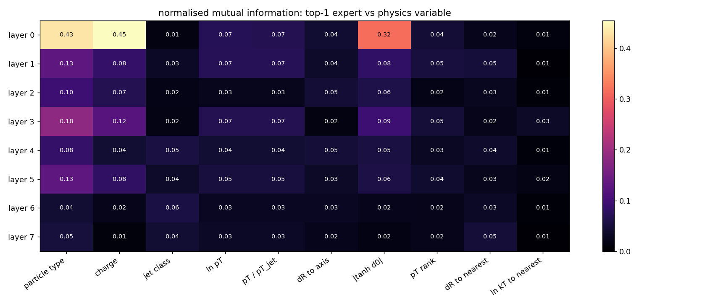
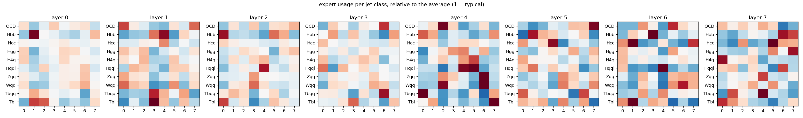

# Expert specialisation: checkpoints\moe8_short\best.pt

20,000 jets, 782,261 particles.

### Layer 0
router entropy 2.07 / 2.08 nats; strongest link: charge 0.45, particle type 0.43, |tanh d0| 0.32
- expert 0 (13% of particles): 1.8x enriched in ch.had; high charged frac; most used by H4q jets; removing it costs Hbb 0.1 pp
- expert 1 (12% of particles): 4.5x enriched in muon; high |tanh d0|, charged frac; most used by Hbb jets; removing it costs Hcc 0.1 pp
- expert 2 (13% of particles): 2.2x enriched in photon; high dR to axis, pT rank; low ln pT, pT / pT_jet; most used by Tbl jets; removing it costs Hcc 0.1 pp
- expert 3 (13% of particles): 2.0x enriched in ch.had; high ln pT, pT / pT_jet; low pT rank; most used by QCD jets; removing it costs Hcc 0.2 pp
- expert 4 (13% of particles): 3.3x enriched in neu.had; high ln kT to nearest; most used by Hgg jets; removing it costs QCD 0.0 pp
- expert 5 (14% of particles): 2.5x enriched in electron; high dR to nearest, pT / pT_jet; most used by Wqq jets; removing it costs QCD 0.1 pp
- expert 6 (11% of particles): 2.2x enriched in photon; high pT rank; low ln kT to nearest, dR to axis; most used by Wqq jets; removing it costs Hbb 0.1 pp
- expert 7 (10% of particles): 2.0x enriched in neu.had; high ln pT; low pT rank, dR to nearest; most used by Hbb jets; removing it costs QCD -0.0 pp

### Layer 1
router entropy 2.08 / 2.08 nats; strongest link: particle type 0.13, charge 0.08, |tanh d0| 0.08
- expert 0 (12% of particles): 1.1x enriched in photon; most used by QCD jets; removing it costs Hbb -0.0 pp
- expert 1 (13% of particles): 2.3x enriched in neu.had; high charged frac, ln pT; low pT rank, dR to nearest; most used by Hqql jets; removing it costs Hbb 0.1 pp
- expert 2 (15% of particles): 1.4x enriched in photon; high |tanh d0|; low charged frac; most used by H4q jets; removing it costs Hbb 0.1 pp
- expert 3 (13% of particles): 1.3x enriched in ch.had; high dR to axis, dR to nearest; low ln pT, pT / pT_jet; most used by Tbl jets; removing it costs Hbb 0.1 pp
- expert 4 (15% of particles): 3.2x enriched in muon; high pT / pT_jet, ln pT; low pT rank, dR to nearest; most used by Hbb jets; removing it costs Hbb 0.1 pp
- expert 5 (11% of particles): 1.8x enriched in photon; low charged frac; most used by Wqq jets; removing it costs QCD -0.0 pp
- expert 6 (12% of particles): 3.9x enriched in electron; high |tanh d0|; low ln kT to nearest; most used by Tbqq jets; removing it costs Hbb 0.1 pp
- expert 7 (8% of particles): 1.5x enriched in electron; high ln kT to nearest, charged frac; most used by QCD jets; removing it costs Hbb -0.0 pp

### Layer 2
router entropy 2.08 / 2.08 nats; strongest link: particle type 0.10, charge 0.07, |tanh d0| 0.06
- expert 0 (13% of particles): 1.8x enriched in neu.had; high dR to axis; low charged frac; most used by Hbb jets; removing it costs Hbb -0.0 pp
- expert 1 (12% of particles): 1.2x enriched in ch.had; high |tanh d0|; most used by Tbqq jets; removing it costs Hbb -0.0 pp
- expert 2 (13% of particles): 1.5x enriched in ch.had; high charged frac; low dR to nearest, ln kT to nearest; most used by Tbqq jets; removing it costs QCD -0.0 pp
- expert 3 (12% of particles): 1.3x enriched in muon; high ln pT, pT / pT_jet; low pT rank; most used by Wqq jets; removing it costs QCD 0.1 pp
- expert 4 (13% of particles): 2.9x enriched in neu.had; high |tanh d0|; most used by Hqql jets; removing it costs Hcc 0.1 pp
- expert 5 (11% of particles): 1.4x enriched in photon; most used by Hbb jets; removing it costs QCD -0.0 pp
- expert 6 (14% of particles): 1.5x enriched in ch.had; high charged frac, pT rank; low ln pT, pT / pT_jet; most used by Hbb jets; removing it costs Hbb 0.1 pp
- expert 7 (12% of particles): 4.0x enriched in muon; high dR to nearest, dR to axis; most used by QCD jets; removing it costs Hbb 0.1 pp

### Layer 3
router entropy 2.07 / 2.08 nats; strongest link: particle type 0.18, charge 0.12, |tanh d0| 0.09
- expert 0 (11% of particles): 2.0x enriched in neu.had; most used by Hqql jets; removing it costs Hbb 0.1 pp
- expert 1 (14% of particles): 3.2x enriched in muon; low dR to nearest; most used by Hbb jets; removing it costs Hcc 0.1 pp
- expert 2 (11% of particles): 1.3x enriched in ch.had; low dR to axis; most used by Hqql jets; removing it costs Hbb 0.1 pp
- expert 3 (10% of particles): 1.6x enriched in ch.had; high |tanh d0|, charged frac; low dR to axis; most used by Tbl jets; removing it costs Hcc 0.1 pp
- expert 4 (13% of particles): 2.8x enriched in muon; high pT / pT_jet, |tanh d0|; low pT rank; most used by H4q jets; removing it costs Hbb 0.1 pp
- expert 5 (13% of particles): 3.9x enriched in neu.had; high dR to nearest, dR to axis; low charged frac, |tanh d0|; most used by Wqq jets; removing it costs QCD -0.0 pp
- expert 6 (10% of particles): 1.8x enriched in electron; high pT rank; low pT / pT_jet; most used by Tbqq jets; removing it costs Hbb 0.1 pp
- expert 7 (17% of particles): 2.0x enriched in photon; high pT rank; low ln kT to nearest, ln pT; most used by Hbb jets; removing it costs QCD -0.0 pp

### Layer 4
router entropy 2.07 / 2.08 nats; strongest link: particle type 0.08, jet class 0.05, |tanh d0| 0.05
- expert 0 (14% of particles): 1.7x enriched in neu.had; high |tanh d0|, pT / pT_jet; most used by Tbqq jets; removing it costs Hbb 0.1 pp
- expert 1 (12% of particles): 1.2x enriched in neu.had; high dR to nearest, pT rank; low ln pT, pT / pT_jet; most used by Tbl jets; removing it costs QCD -0.0 pp
- expert 2 (11% of particles): 2.6x enriched in muon; high pT rank; low charged frac; most used by QCD jets; removing it costs Hbb 0.1 pp
- expert 3 (14% of particles): 2.5x enriched in muon; high pT / pT_jet, ln pT; low pT rank, dR to axis; most used by Hgg jets; removing it costs QCD -0.0 pp
- expert 4 (11% of particles): 1.4x enriched in photon; low ln kT to nearest; most used by Hqql jets; removing it costs QCD -0.0 pp
- expert 5 (13% of particles): 2.5x enriched in neu.had; high dR to axis, ln kT to nearest; most used by Hqql jets; removing it costs QCD -0.0 pp
- expert 6 (11% of particles): 1.2x enriched in photon; most used by Wqq jets; removing it costs Hbb 0.1 pp
- expert 7 (14% of particles): 1.5x enriched in muon; high charged frac; most used by Tbl jets; removing it costs Hbb 0.1 pp

### Layer 5
router entropy 2.07 / 2.08 nats; strongest link: particle type 0.13, charge 0.08, |tanh d0| 0.06
- expert 0 (11% of particles): 1.4x enriched in photon; most used by Tbqq jets; removing it costs QCD -0.0 pp
- expert 1 (11% of particles): 2.4x enriched in neu.had; most used by Hbb jets; removing it costs QCD -0.0 pp
- expert 2 (14% of particles): 3.3x enriched in muon; high pT / pT_jet, ln pT; low pT rank, dR to nearest; most used by Tbl jets; removing it costs Hbb 0.1 pp
- expert 3 (12% of particles): 1.3x enriched in ch.had; high |tanh d0|, dR to nearest; most used by Hcc jets; removing it costs Hbb 0.1 pp
- expert 4 (12% of particles): 1.6x enriched in neu.had; high dR to nearest; most used by Wqq jets; removing it costs QCD -0.0 pp
- expert 5 (14% of particles): 2.2x enriched in photon; high pT rank; low ln kT to nearest, charged frac; most used by Hgg jets; removing it costs QCD 0.0 pp
- expert 6 (11% of particles): 1.3x enriched in ch.had; most used by Tbqq jets; removing it costs Hbb -0.0 pp
- expert 7 (15% of particles): 2.0x enriched in neu.had; high ln pT; low pT rank, dR to axis; most used by QCD jets; removing it costs Hcc 0.1 pp

### Layer 6
router entropy 2.07 / 2.08 nats; strongest link: jet class 0.06, particle type 0.04, dR to nearest 0.03
- expert 0 (11% of particles): 1.1x enriched in photon; most used by Tbl jets; removing it costs Hbb -0.0 pp
- expert 1 (11% of particles): 1.2x enriched in neu.had; high |tanh d0|, pT rank; low ln pT, pT / pT_jet; most used by Tbl jets; removing it costs QCD -0.0 pp
- expert 2 (11% of particles): 1.5x enriched in ch.had; high charged frac, dR to nearest; most used by QCD jets; removing it costs QCD -0.0 pp
- expert 3 (13% of particles): 2.0x enriched in neu.had; high dR to axis; low charged frac; most used by Hbb jets; removing it costs QCD 0.0 pp
- expert 4 (14% of particles): 1.3x enriched in neu.had; high dR to axis, dR to nearest; most used by Hqql jets; removing it costs Hbb 0.1 pp
- expert 5 (14% of particles): 1.3x enriched in photon; low ln kT to nearest, dR to nearest; most used by QCD jets; removing it costs Hbb -0.0 pp
- expert 6 (13% of particles): 4.4x enriched in muon; high ln pT, pT / pT_jet; low pT rank, dR to axis; most used by Wqq jets; removing it costs Hbb -0.0 pp
- expert 7 (12% of particles): 1.4x enriched in photon; low charged frac, dR to nearest; most used by Hcc jets; removing it costs Hbb 0.1 pp

### Layer 7
router entropy 2.08 / 2.08 nats; strongest link: particle type 0.05, dR to nearest 0.05, jet class 0.04
- expert 0 (13% of particles): 1.2x enriched in photon; high dR to axis; most used by H4q jets; removing it costs Hbb 0.1 pp
- expert 1 (13% of particles): 1.3x enriched in photon; high pT / pT_jet; low |tanh d0|, charged frac; most used by Tbqq jets; removing it costs Hbb 0.1 pp
- expert 2 (12% of particles): 1.2x enriched in ch.had; high dR to nearest, pT rank; low ln pT, pT / pT_jet; most used by Hcc jets; removing it costs Hbb -0.0 pp
- expert 3 (13% of particles): 3.1x enriched in neu.had; high pT / pT_jet, ln kT to nearest; low pT rank; most used by Wqq jets; removing it costs QCD -0.0 pp
- expert 4 (13% of particles): 1.2x enriched in ch.had; high |tanh d0|, charged frac; low ln kT to nearest; most used by Tbqq jets; removing it costs Hbb 0.1 pp
- expert 5 (11% of particles): 3.2x enriched in electron; low dR to axis, ln kT to nearest; most used by Hcc jets; removing it costs QCD 0.0 pp
- expert 6 (13% of particles): 1.2x enriched in photon; low charged frac; most used by Hbb jets; removing it costs QCD -0.0 pp
- expert 7 (12% of particles): 1.1x enriched in ch.had; most used by Hgg jets; removing it costs QCD -0.0 pp
