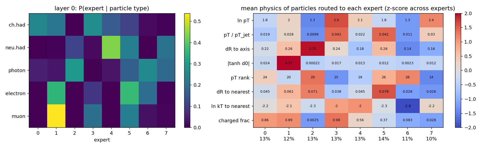
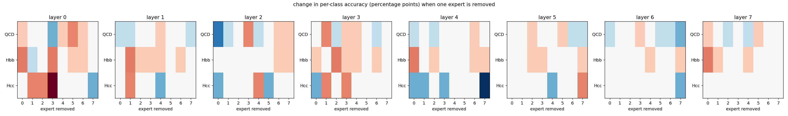

# First results

These numbers come from the files in the repository (`analysis/moe8_short/report.json`, `REPORT.md` and the README).
They are **preliminary**: one short fine-tune and one seed.

## Run

The dense `v2_shared_10M_10ep` GDS-ParT checkpoint was upcycled to 8 experts with top-2 routing in all 8 blocks
(upcycling noise 0.01, balance weight 1e-2, z-loss weight 1e-3, lr 2e-4, router lr ×5). It was fine-tuned for
one epoch on 300k JetClass jets and validated on 20,000 jets.

| Model | Val. accuracy | Val. AUC (macro OvO) |
|---|---|---|
| Dense GDS-ParT (`v2_shared`) | 0.8487 | – |
| Upcycled MoE, before fine-tuning | 0.8479 | – |
| Upcycled MoE, after 1 epoch | 0.8472 | 0.9852 |

The model has 9,458,484 parameters; about 3.1M act on any one particle.

## Mutual information per layer

Analysis on 20,000 validation jets (782,261 particles). Router entropy has a maximum of ln 8 ≈ 2.079 nats.

| Layer | Entropy | type | charge | \|tanh d0\| | ln pT | ΔR to nearest | jet class |
|---|---|---|---|---|---|---|---|
| 0 | 2.072 | **0.432** | **0.455** | **0.317** | 0.068 | 0.024 | 0.015 |
| 1 | 2.075 | 0.130 | 0.084 | 0.082 | 0.070 | 0.048 | 0.033 |
| 2 | 2.075 | 0.095 | 0.067 | 0.060 | 0.026 | 0.027 | 0.020 |
| 3 | 2.074 | 0.184 | 0.122 | 0.094 | 0.066 | 0.022 | 0.018 |
| 4 | 2.075 | 0.085 | 0.044 | 0.054 | 0.044 | 0.037 | 0.054 |
| 5 | 2.075 | 0.130 | 0.079 | 0.058 | 0.052 | 0.025 | 0.037 |
| 6 | 2.074 | 0.044 | 0.023 | 0.024 | 0.029 | 0.032 | 0.056 |
| 7 | 2.075 | 0.051 | 0.012 | 0.017 | 0.033 | 0.047 | 0.043 |

## Layer 0: experts split by species

| Expert | Load | Most enriched type | Charged frac. | mean ln pT | mean \|tanh d0\| | mean ΔR to axis |
|---|---|---|---|---|---|---|
| 0 | 13.4% | ch. hadron (1.8×) | 0.86 | 1.75 | 0.024 | 0.22 |
| 1 | 11.9% | **muon (4.5×)** | 0.89 | 2.02 | **0.370** | 0.26 |
| 2 | 12.9% | photon (2.2×) | 0.00 | 1.27 | 0.000 | 0.35 |
| 3 | 13.0% | ch. hadron (2.0×) | 0.98 | 2.65 | 0.017 | 0.24 |
| 4 | 13.1% | neu. hadron (3.3×) | 0.56 | 2.07 | 0.013 | 0.18 |
| 5 | 14.4% | electron (2.5×) | 0.37 | 1.77 | 0.012 | 0.27 |
| 6 | 11.3% | photon (2.2×) | 0.08 | 1.35 | 0.002 | 0.14 |
| 7 | 10.0% | neu. hadron (2.0×) | 0.03 | 2.44 | 0.012 | 0.16 |

Expert 1 takes 53.8% of all muons and the most displaced tracks, and it is the expert most used by H→bb̄ jets
(23.7% of their particles, against 7.5% for QCD). Experts 2 and 6 take soft wide-angle and collinear photons,
experts 4 and 7 neutral hadrons, and expert 3 the hardest charged hadrons.

## Knockout

The stored knockout pass covers QCD, Hbb and Hcc only. Removing any single expert changes per-class accuracy by at
most 0.2 percentage points (one or two jets), which is within noise.

## What this means

- Layer 0 already reads particle identity and track displacement, which are explicit input features.
- Layers 1–7 are still almost uniform: the upcycled experts have not diverged after one epoch.
- Next: train for 3+ epochs on the full 10M cache, sweep `--aux_weight 1e-3`, `--top_k 1` and `--moe_layers 4,5,6,7`,
  repeat with a second seed, and run knockout on a class-balanced sample.

The full per-layer report is in
[`analysis/moe8_short/REPORT.md`](https://github.com/Avinashistoocool/GDS-parT-MoE/blob/main/analysis/moe8_short/REPORT.md).
